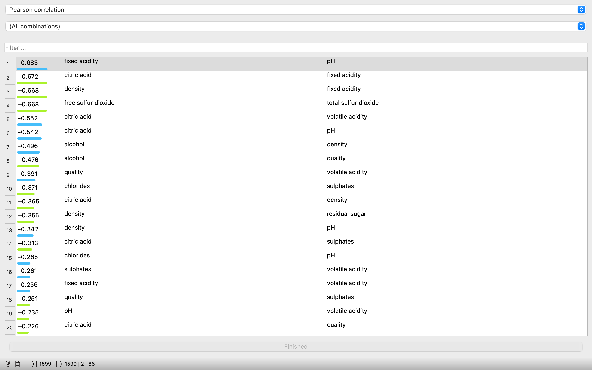

# 🍷 Predicting Red Wine Quality

  

Archived coursework: the group term project for LIS4761 Data Mining and Analytics (Fall 2021). We looked at which physicochemical properties drive red wine quality and classified 1,599 Vinho Verde red wines into quality categories. There is no code here, only the dataset, the Orange3 workflow, weekly reports and the presentations.

### ✨ What's in it
- 📊 `winequality-red.csv`: the UCI Red Wine Quality dataset with an added `quality category` column (poor / good / excellent)
- 🔗 Correlation analysis of every attribute against quality (alcohol, volatile acidity and sulphates had the strongest effect)
- 🤖 Random Forest, Naive Bayes and Random Tree classifiers in Weka with 10-fold cross validation, about 82% accuracy each
- 🧩 `Orange Workflow.ows`: the Orange3 workflow used for the visualizations
- 📝 Proposal, weekly reports, midterm and final presentations, and the final report (`Final Report Group 4_.docx`)

### 🖼️ Charts

### 🚀 Opening it
- Open the `.ows` file in [Orange3](https://orangedatamining.com/) and point its CSV File Import widget at `winequality-red.csv`.
- Load the CSV in [Weka](https://waikato.github.io/weka-wiki/) to rerun the classifiers.

### 🙌 Credits
- Group 4: Tyler S. Perry, Fabio Nasseh, Mehmet Ozmen
- Dataset: P. Cortez, A. Cerdeira, F. Almeida, T. Matos and J. Reis, "Modeling wine preferences by data mining from physicochemical properties", Decision Support Systems 47(4), 2009 ([Kaggle](https://www.kaggle.com/uciml/red-wine-quality))

### 📄 License
MIT
